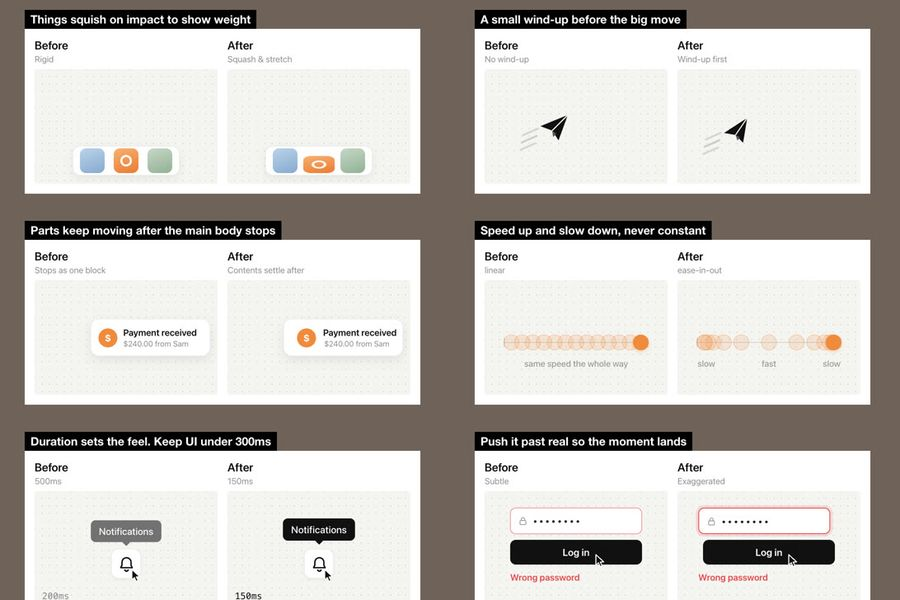
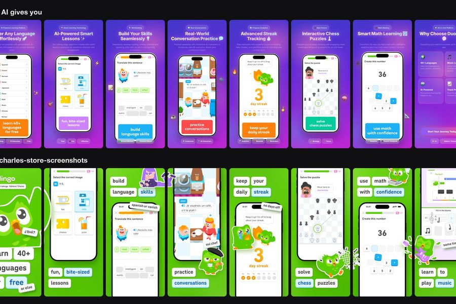

# Charles's skills

[](https://skills.sh/LemonFace0309/charles-skills)
[](LICENSE)

The skills I use to design apps and make my reels, for Claude Code, Codex and any agent that reads `SKILL.md`. Every
skill I've given away in a reel lives here too.

<p align="center">
<a href="skills/drops/charles-ux-animation/"></a>
<a href="skills/drops/charles-hero-mockups/"></a>
<a href="skills/design/charles-store-screenshots/"></a>
<a href="skills/editing/charles-3d-explainers/"></a>
</p>

## Commented on a reel?

Find the word you commented:

| Comment | Skill | What it does |
| --- | --- | --- |
| MOTION | [charles-ux-animation](skills/drops/charles-ux-animation/) | The 20 principles of UX and animation, as steps your agent follows |
| UNSLOP | [charles-unslop](skills/design/charles-unslop/) | Turns UI that looks AI-made into a designed screen |
| POLISH | [charles-polish](skills/design/charles-polish/) | Fixes the details and the motion, checked frame by frame |
| ACCENT | [charles-hero-mockups](skills/drops/charles-hero-mockups/) | Mocks up poster-like landing-page heroes, each with one bold accent colour |
| COLOR | [charles-color-analysis](skills/drops/charles-color-analysis/) | Critiques the colour of a design, with exact fixes |

## Install

```bash
npx skills add LemonFace0309/charles-skills --skill charles-unslop
```

Swap in the skill you want. Leave off `--skill` to pick from a list grouped by shelf, and add `-g` to install it for
every project.

<details>
<summary>Claude Code plugins, or by hand</summary>

<br>

In Claude Code you can add a whole shelf at once:

```text
/plugin install drops --marketplace LemonFace0309/charles-skills
/plugin install design --marketplace LemonFace0309/charles-skills
/plugin install editing --marketplace LemonFace0309/charles-skills
/plugin install qol --marketplace LemonFace0309/charles-skills
```

On Claude Code before 2.1.275, run `/plugin marketplace add LemonFace0309/charles-skills` first, then
`/plugin install design@charles-skills`. A plugin skill is called with its shelf in front, like
`/design:charles-unslop`. Pick one way to install: a skill installed both ways loads twice.

By hand, copy a skill's folder into `~/.claude/skills/` for Claude Code or `~/.agents/skills/` for Codex:

```bash
git clone https://github.com/LemonFace0309/charles-skills
cp -R charles-skills/skills/design/charles-unslop ~/.claude/skills/
```

</details>

## Use

Start a new session, then ask for it by name:

```text
/charles-unslop this login page
/charles-ux-animation the add-to-cart flow
/charles-hero-mockups four landing-page heroes for a ceramics studio, from my reference folder
/charles-color-analysis critique the colours of my landing-page hero, hero.png
/charles-reel-plans an evolution of design reel, from this post, structured like my 22 Backgrounds reel
```

Codex uses `$charles-unslop` instead of the slash.

## The skills

### [Drops](skills/drops/): made for a reel, given away in the DMs

| Skill | What it does |
| --- | --- |
| [charles-ux-animation](skills/drops/charles-ux-animation/) | Builds and reviews how an interface moves and responds, using the 20 principles of UX and animation |
| [charles-hero-mockups](skills/drops/charles-hero-mockups/) | Mocks up poster-like landing-page heroes as images, each with one bold accent colour |
| [charles-color-analysis](skills/drops/charles-color-analysis/) | Critiques the colour of a graphic, landing page, app screen or palette, with exact fixes and before/after previews |

### [Design](skills/design/): what I use on my own apps

| Skill | What it does |
| --- | --- |
| [charles-unslop](skills/design/charles-unslop/) | Turns UI that looks AI-made into a designed screen with its own point of view |
| [charles-polish](skills/design/charles-polish/) | Takes UI that works and fixes the details and motion, checked frame by frame |
| [charles-unreasonable-craft](skills/design/charles-unreasonable-craft/) | Holds a site or app design to the bar of an Awwwards Site of the Day and an Apple Design Award |
| [charles-store-screenshots](skills/design/charles-store-screenshots/) | Designs App Store screenshot sets and renders them at Apple's exact sizes |

### [Editing](skills/editing/): how I make my reels

| Skill | What it does |
| --- | --- |
| [charles-reel-plans](skills/editing/charles-reel-plans/) | Plans a reel before it's filmed: the script, real assets, the caption, the music and a shareable mockup page |
| [charles-scripting-voice](skills/editing/charles-scripting-voice/) | Writes the words I say on camera so they sound like me talking, not like an AI script |
| [charles-claude-editing](skills/editing/charles-claude-editing/) | Edits talking-head footage into Reels and TikToks |
| [charles-explainers-assets](skills/editing/charles-explainers-assets/) | Makes the visual that teaches each line of a reel, timed to the words |
| [charles-3d-explainers](skills/editing/charles-3d-explainers/) | Makes 3D explainer reels from a voiceover, and 3D cutaways for talking-head videos |
| [charles-arcade-assets](skills/editing/charles-arcade-assets/) | Makes pixel-art motion graphics timed to a voiceover |

### [QoL](skills/qol/): small things that save time

| Skill | What it does |
| --- | --- |
| [charles-storage-cleanup](skills/qol/charles-storage-cleanup/) | Finds what's filling a Mac and removes what's safe to delete |

## Credits

- `charles-unslop` is adapted from [unslop](https://github.com/heydamir/unslop) by Damir Sokolovsky and draws on Emil
  Kowalski's unslop design skill.
- `charles-polish` is built from Emil Kowalski's UI polish and animation skills and Josh Puckett's Interface Craft.
- `charles-ux-animation` is built on Disney's 12 principles of animation (Frank Thomas and Ollie Johnston, *The
  Illusion of Life*), Raphael Salaja's [userinterface.wiki](https://www.userinterface.wiki), Jon Yablonski's
  [Laws of UX](https://lawsofux.com), Emil Kowalski's animation skill and his rule on frequency of use, and Josh
  Puckett's Interface Craft.

## License

MIT, except `charles-unslop`, which is CC BY 4.0 like the unslop it's adapted from. The fonts in the editing kits are
under the SIL Open Font License, with each licence beside its font, and the Earth textures and 3D models in
`charles-3d-explainers/kit` list their sources and licences in a `NOTICE.md` beside them.
