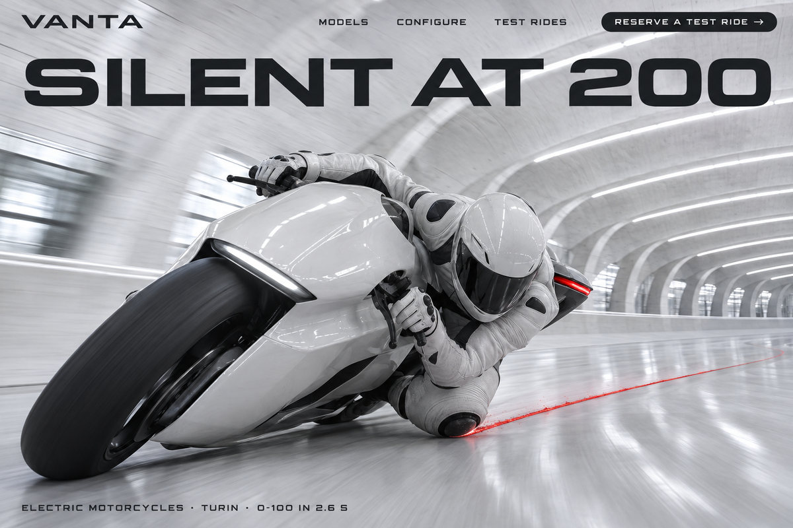
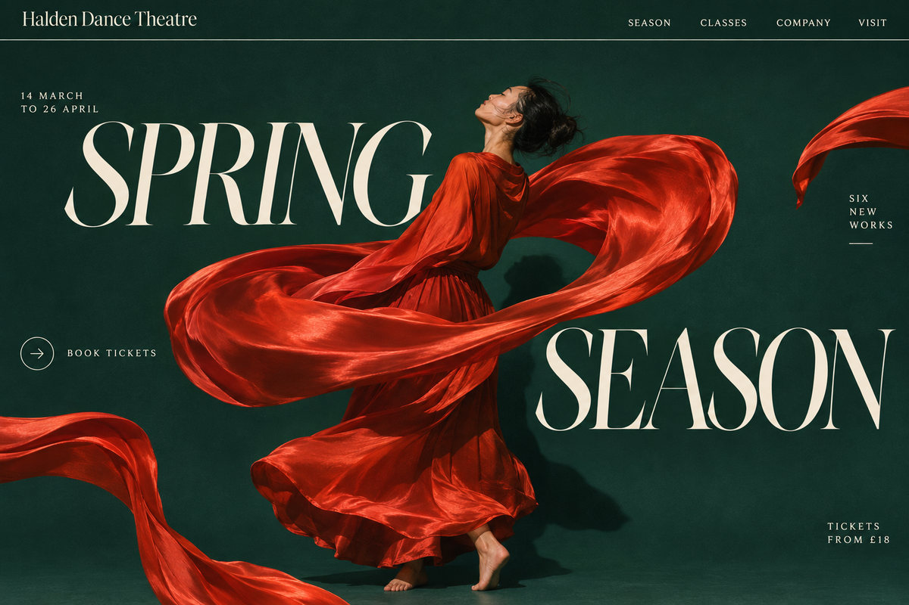
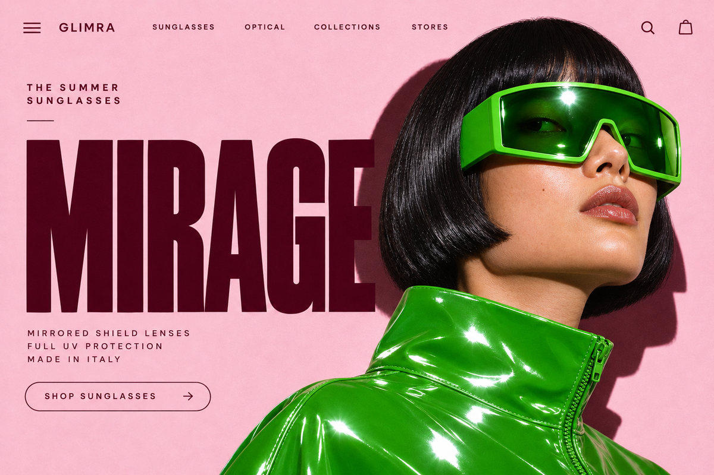
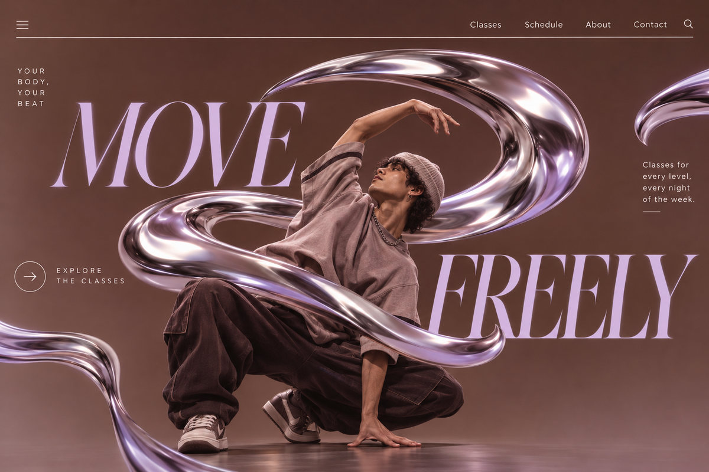
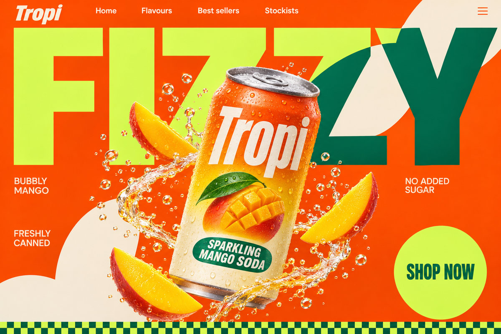
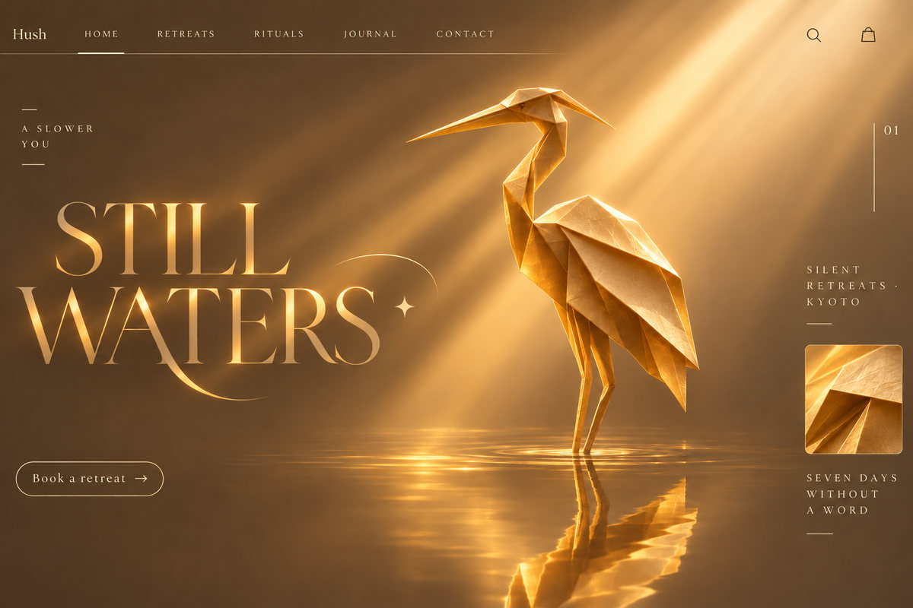

# charles-accent-heroes

Makes landing-page hero images that read like posters: one striking subject, big type tied to it, a quiet interface and
one bold accent colour. Each page is a close variation of a reference screenshot you give it, rendered with GPT Image,
then checked and fixed with small edits.

## Examples

Six heroes it made:

<p align="center">






</p>

## Needs

Python 3 with numpy, requests and Pillow, and an OpenAI API key (`OPENAI_API_KEY`). Renders cost about $0.05 each. The
check that reads every word back only runs on macOS.

## Use

```text
/charles-accent-heroes four heroes for a ceramics studio, from my reference folder
/charles-accent-heroes one hero for my dance studio, from the screenshots in ./refs
```
