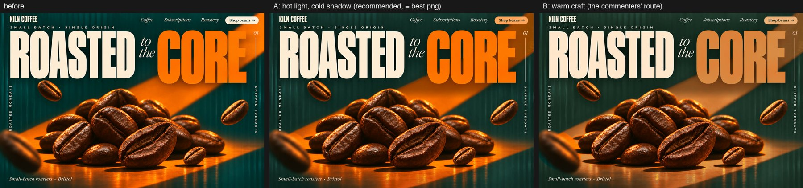

# charles-color-analysis

Critiques colour the way a designer would, with numbers. It works out what the visual is for (a graphic that has to
stop the scroll, a landing page, or an app screen), measures the real colours (the 60/30/10 split, lightness, hue gaps,
chroma, temperature and text contrast), and gives exact OKLCH and hex fixes with before/after previews. It also judges
a bare palette, and whether someone else's colour critique is right.

## Examples

A coffee roaster's hero, critiqued after commenters said its orange clashed with the teal. The skill found the pairing
was right but one flat orange was doing three jobs (the light on the wall, the light on the table and the word CORE).
Its fix turns the light on the wall into a deeper amber that falls off and the teal 13° warmer, so CORE reads and warm
leads. Left to right: before, the recommended fix, and the commenters' desaturated version.



## Needs

Python 3 with numpy and Pillow. Reading the text in an image uses macOS; rendering a page (`shot`) uses Chrome or
Chromium. No API keys.

## Install

```bash
npx skills add LemonFace0309/charles-skills --skill charles-color-analysis
```

Add `-g` to install it for every project, or copy this folder into `~/.claude/skills/` (Claude Code) or
`~/.agents/skills/` (Codex).

## Use

```text
/charles-color-analysis critique the colours of my landing-page hero, hero.png
/charles-color-analysis is this palette any good for a meditation app? #6C5CE7 #A29BFE #FD79A8 #2D3436 #FFFFFF
/charles-color-analysis someone said my orange clashes with the green, are they right? poster.jpg
```
