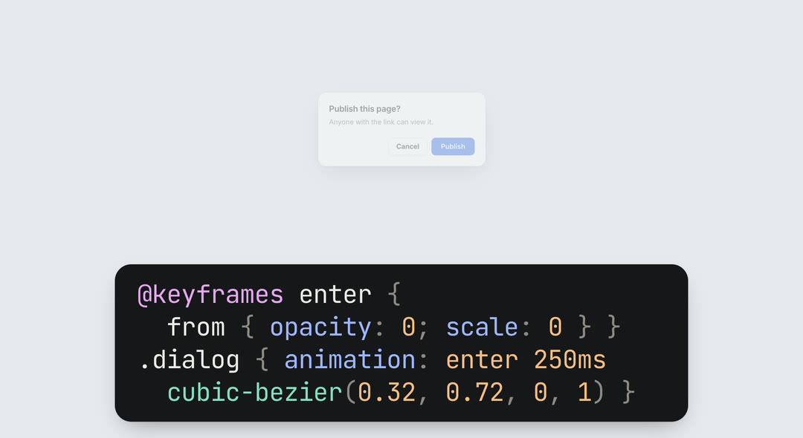
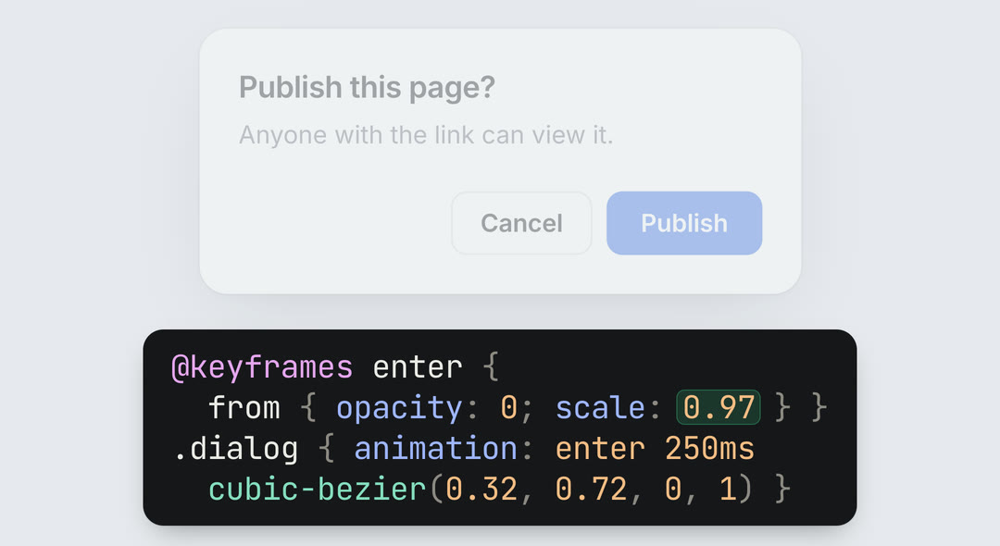

# charles-explainers-assets

Builds the visual that teaches each line of a reel: a fix that flips from before to after on your word with its code
under it, a principle side by side without it and with it, or a term's definition above a demo. Every flip marks what
changes, in red on the problem and green as it's fixed: a guide that straightens, a hatched band over a space,
corner brackets, a before/after sweep, or the agent cursor moving the part itself. Each clip is sized for its slot in your
edit, timed to your words, and simple enough to read in the second or two a phone viewer gets.

## Examples

One fix from my animation hacks reel, before and after the word, with its CSS under it:

<p align="center">


</p>

## Needs

Bun, Google Chrome and ffmpeg.

## Install

```bash
npx skills add LemonFace0309/charles-skills --skill charles-explainers-assets
```

Add `-g` to install it for every project, or copy this folder into `~/.claude/skills/` (Claude Code) or
`~/.agents/skills/` (Codex).

## Use

```text
/charles-explainers-assets a before and after for "use tabular numbers", for a 1080x960 card
/charles-explainers-assets a teaching visual for every line of script.md
```
