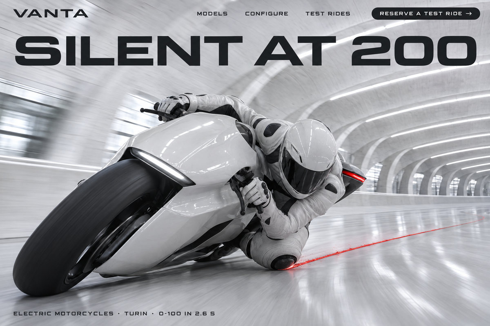
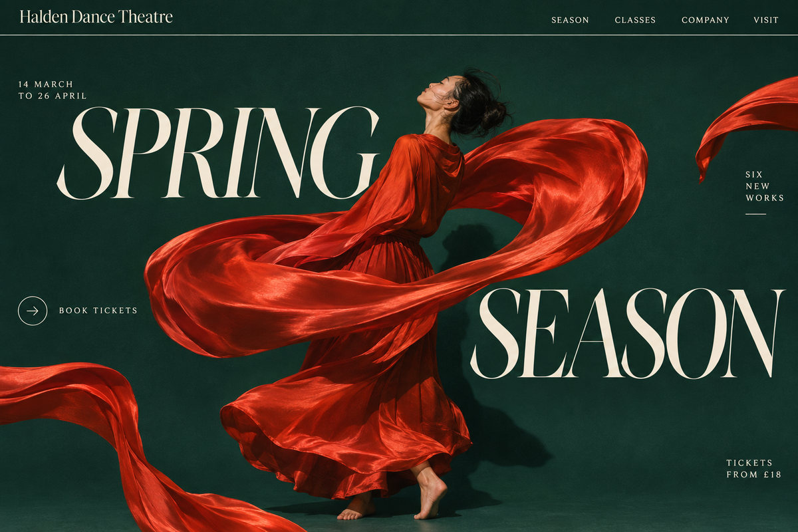
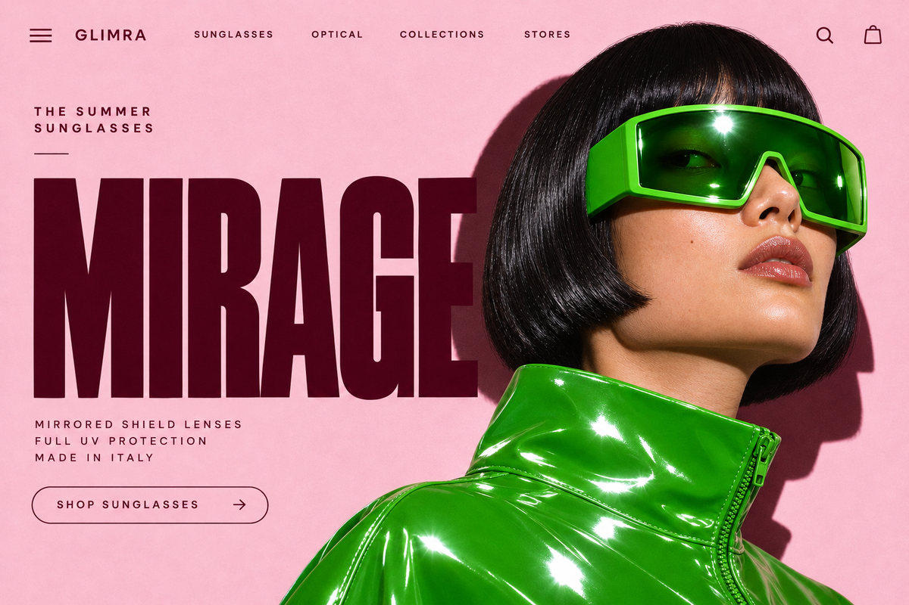
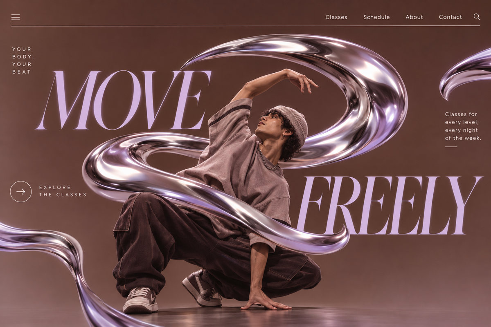
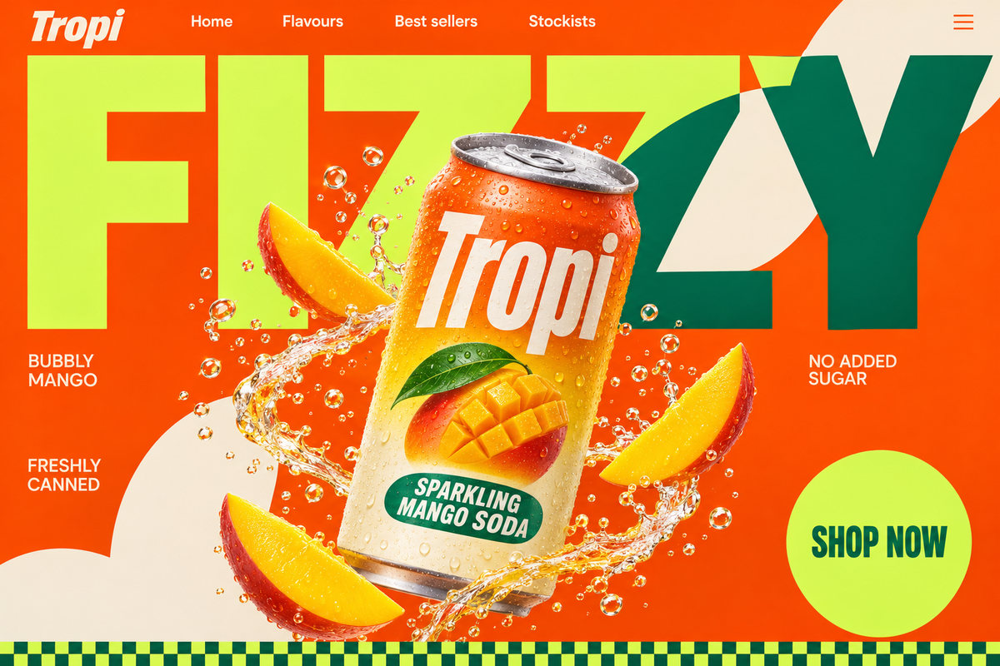
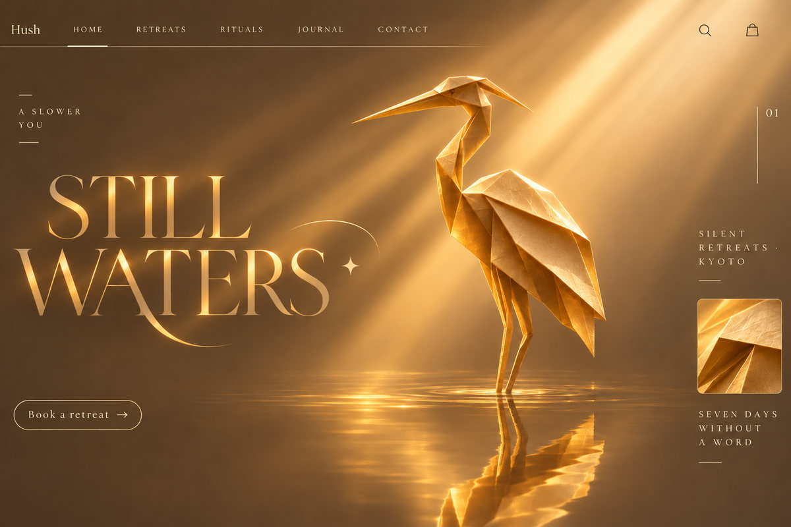

# charles-hero-mockups

Mocks up landing-page heroes as images that read like posters: one striking subject, big type tied to it, a quiet
interface and one bold accent colour. Use it to explore a site's art direction before you build it, to pitch directions,
or for finished hero graphics. Each page is a close variation of a reference screenshot you give it, rendered with GPT
Image, then checked and fixed with small edits.

It was called `charles-accent-heroes` until 16 Nov 2026.

## Examples

Six heroes it made:

<p align="center">






</p>

## Needs

Python 3 with numpy, requests and Pillow, and an OpenAI API key (`OPENAI_API_KEY`). Renders cost about $0.05 each. The
check that reads every word back only runs on macOS.

## Install

```bash
npx skills add LemonFace0309/charles-skills --skill charles-hero-mockups
```

Add `-g` to install it for every project, or copy this folder into `~/.claude/skills/` (Claude Code) or
`~/.agents/skills/` (Codex).

## Use

```text
/charles-hero-mockups four heroes for a ceramics studio, from my reference folder
/charles-hero-mockups three hero directions for my app's landing page, from the screenshots in ./refs
```
