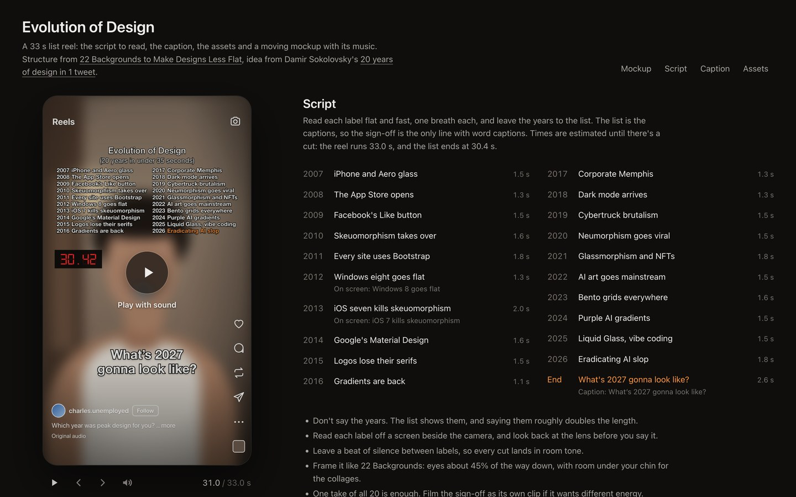

# charles-reel-plans

Plans a reel before you film it. Give it a video idea and a reference (one of your reels, someone else's, or a post to
credit). It tears the reference down, writes the script in your voice, finds the real assets with their licences, writes
the caption with the credit, and picks the music and where it starts. Then it publishes a plan page you can open on your
phone. On that page the reel plays as a moving mockup with its music, over a blurred stand-in for your footage, with
Instagram's buttons and the safe area on top. The script, the caption and every asset with its source sit under it. All
that's left is to read the script and film, and the plan file tells the editing session what goes where.

## Examples

The plan page for "Evolution of Design", a 20-year list reel: the list fills in as you speak, the newest year in orange,
the stopwatch runs, and each year's real artifacts sit under your chin. This frame is the sign-off.

<p align="center">

</p>

## Needs

Python 3 with Pillow and NumPy, ffmpeg, and Google Chrome. Claude Code's Artifact tool publishes the page; without it,
`build/plan.html` opens from disk. The editing rules come from charles-claude-editing. The script is written with a voice
skill: Charles's own, charles-scripting-voice, stays private, so bring yours or give it a few of your scripts.

## Install

```bash
npx skills add LemonFace0309/charles-skills --skill charles-reel-plans
```

Add `-g` to install it for every project, or copy this folder into `~/.claude/skills/` (Claude Code) or
`~/.agents/skills/` (Codex).

## Use

```text
/charles-reel-plans an evolution of design reel, from this post, structured like my 22 Backgrounds reel
/charles-reel-plans why every app icon is a squircle, about 25 s, with a hook
```
