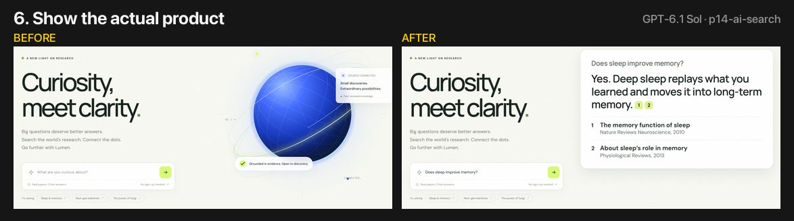
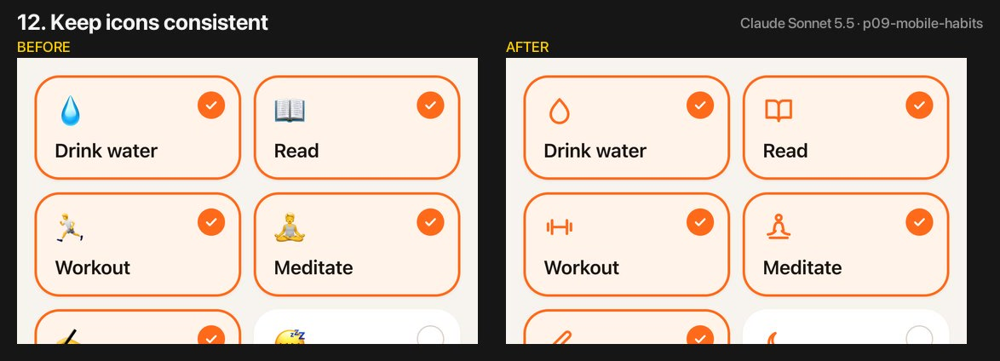
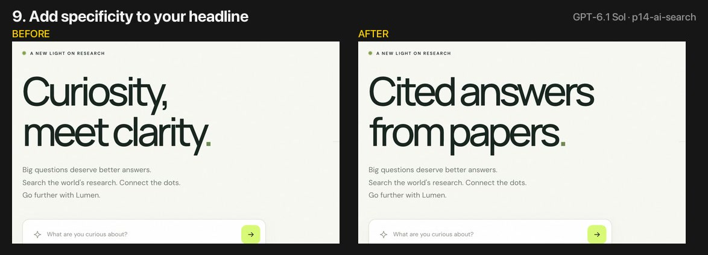

# charles-unslop

Turns a screen that looks AI-made into one with its own point of view. It finds the tells (glows, emoji icons, pill
badges, generic headlines), deletes what doesn't earn its place, fixes spacing, colour, icons, copy and type in order,
and then gives the screen one moment only that product could have.

## Examples

Fixes from my "20 Ways to Unslop AI Designs" reel, on pages that AI models built:







## Install

```bash
npx skills add LemonFace0309/charles-skills --skill charles-unslop
```

Add `-g` to install it for every project, or copy this folder into `~/.claude/skills/` (Claude Code) or
`~/.agents/skills/` (Codex).

## Use

```text
/charles-unslop this login page
/charles-unslop review the dashboard an agent just built
```

## Credits

Adapted from [unslop](https://github.com/heydamir/unslop) by Damir Sokolovsky, CC BY 4.0.
