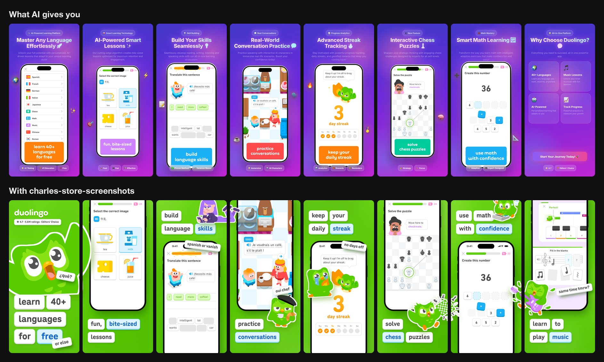
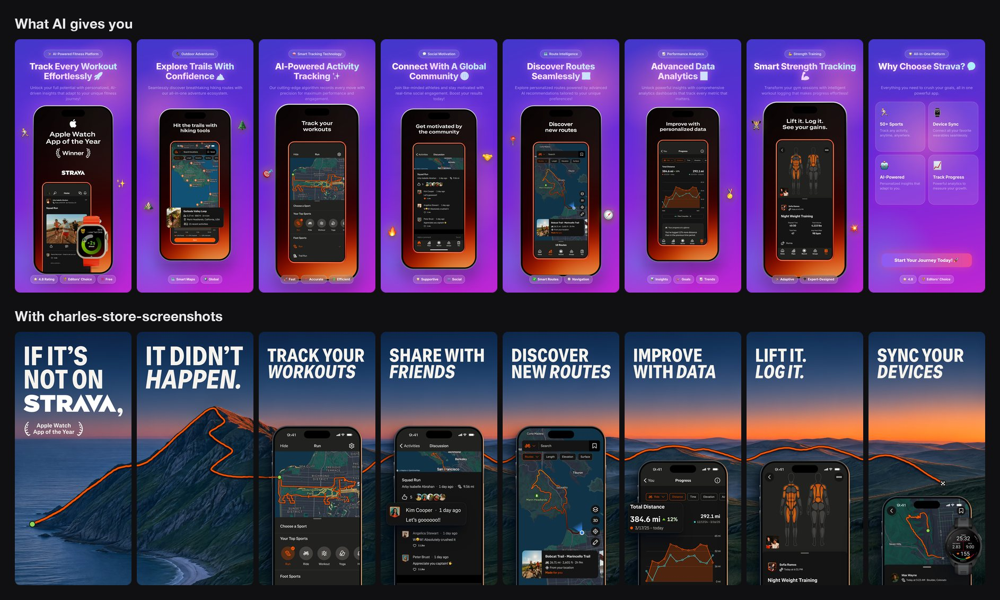
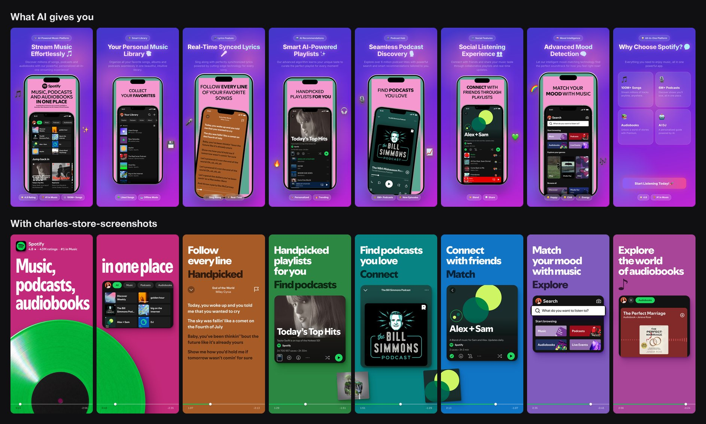
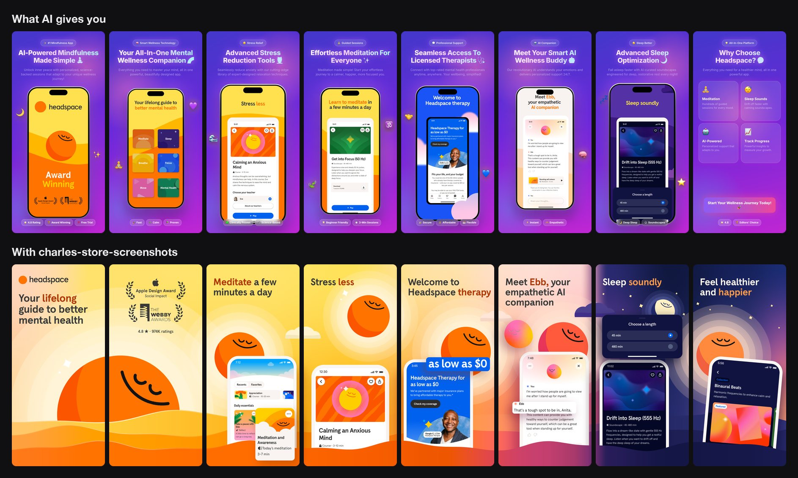

# charles-store-screenshots

Designs App Store and Play Store screenshot sets: a two-frame hook, frames that run into each other like one picture,
and your real app UI at its best moment, with the app's real ratings and awards where people decide. Each set is
built in HTML from your captures and photos, rendered to Apple's exact iPhone, iPad and iPhone Duo sizes, and checked
at search-result size and seam by seam, so nothing looks cut off by accident.

## Examples

Concept sets for apps everyone knows, each built from the app's real App Store captures and its own captions. In each
image, the top row is what AI gives you and the bottom row is the skill's set. These are concepts, not the brands' own.


Duolingo: headlines spelled in their word buttons, Duo bursting across the first gap, the real 4.7 stars from 5.6M
ratings under the logo, and the mascots in new poses.


Strava: one dusk coastline and one orange route through every frame, their own saying split across the hook, and Apple's
award on top.


Spotify: their lyric colours, headlines set like their lyrics screen, a record under the hook, and covers across the gaps.


Headspace: one sky from sunrise to night, a giant sun face across the hook, and each payoff lifted out of its phone.

## Needs

Python 3 with Playwright, Pillow and requests, and Google Chrome. Generated art needs an OpenAI API key
(`OPENAI_API_KEY`), and photo cutouts need a fal.ai key (`FAL_KEY`).

## Install

```bash
npx skills add LemonFace0309/charles-skills --skill charles-store-screenshots
```

Add `-g` to install it for every project, or copy this folder into `~/.claude/skills/` (Claude Code) or
`~/.agents/skills/` (Codex).

## Use

```text
/charles-store-screenshots three App Store screenshot sets for my habit tracker, from the captures in ./shots
/charles-store-screenshots critique my current screenshots in ./store
```
