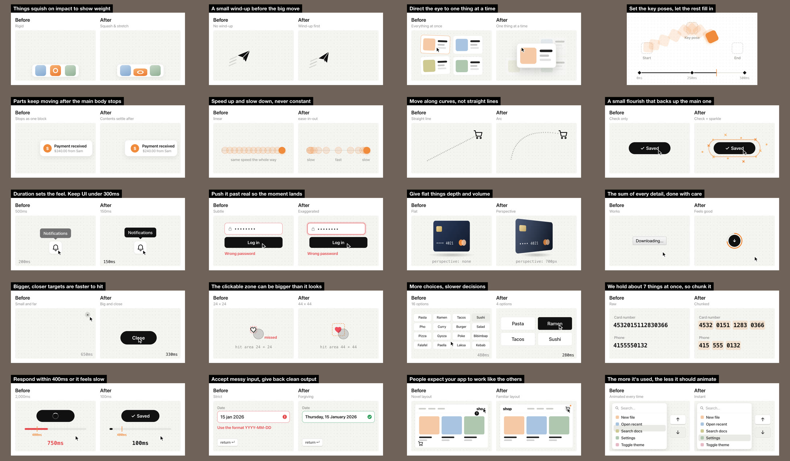

# charles-ux-animation



Makes your app move and respond the way the best ones do: every tip from my two animation reels, as steps your agent
follows whenever it builds or reviews an interaction.

```bash
npx skills add LemonFace0309/charles-skills --skill charles-ux-animation
```

Add `-g` to install it for every project, or copy this folder into `~/.claude/skills/` (Claude Code) or
`~/.agents/skills/` (Codex).

## What it does

- Asks whether something should move at all, and makes every tap answer at once
- Picks how it moves: easing, duration, origin, stagger, arcs and springs
- Checks that people can hit, choose and type into what you built
- Scrubs each animation slowly, interrupts it halfway and turns motion off before it calls it done

## Try it

```text
/charles-ux-animation the add-to-cart flow
/charles-ux-animation review the motion in the onboarding screens
```

## Find a tip from my reels

Each tip links to the part of the skill that has it, with the reason behind it.

**20 Practical Animation Tips** (you commented "animations")

1. [Scale buttons to 0.97](SKILL.md#anticipation-press-and-hover)
2. [Don't animate from scale zero](SKILL.md#origin-and-starting-scale)
3. [Don't animate the next tooltip](SKILL.md#tooltips-after-the-first)
4. [Grow popovers from their button](SKILL.md#origin-and-starting-scale)
5. [Keep animations fast](SKILL.md#timing)
6. [Don't animate keyboard actions](SKILL.md#frequency-of-use)
7. [Don't animate things used very often](SKILL.md#frequency-of-use)
8. [Put hover on a parent that doesn't move](SKILL.md#anticipation-press-and-hover)
9. [Enlarge the tap areas for small buttons](SKILL.md#fittss-law-and-hit-areas)
10. [Use ease-out for enter and exit](SKILL.md#easing)
11. [Use ease-in-out for things moving on screen](SKILL.md#easing)
12. [Turn off hover on touch screens](SKILL.md#anticipation-press-and-hover)
13. [Try out custom easing curves](SKILL.md#easing)
14. [Use blur when transitioning between icons](SKILL.md#swap-in-place)
15. [Chain animations with a stagger](SKILL.md#stagger)
16. [Swap elements in place](SKILL.md#swap-in-place)
17. [Move things along arcs](SKILL.md#arcs)
18. [Add scale and shadow mid-air](SKILL.md#arcs)
19. [Roll numbers like an odometer](SKILL.md#make-it-mean-something)
20. [Fix shaky animations](SKILL.md#shaky-animations)

**20 Principles of UX & Animation** (you commented "motion")

1. [Squash and stretch](SKILL.md#squash-and-stretch)
2. [Anticipation wind-up](SKILL.md#anticipation-press-and-hover)
3. [Staging the focus](SKILL.md#staging)
4. [Pose to pose](SKILL.md#pose-to-pose)
5. [Follow through](SKILL.md#follow-through)
6. [Slow in, slow out](SKILL.md#easing)
7. [Moving in arcs](SKILL.md#arcs)
8. [Secondary action](SKILL.md#secondary-action)
9. [Snappy timing](SKILL.md#timing)
10. [Exaggerated feedback](SKILL.md#exaggeration)
11. [Solid drawing in 3D](SKILL.md#solid-drawing)
12. [Overall appeal](SKILL.md#verify)
13. [Fitts's law](SKILL.md#fittss-law-and-hit-areas)
14. [Bigger hit areas](SKILL.md#fittss-law-and-hit-areas)
15. [Hick's law](SKILL.md#hicks-law)
16. [Miller's law](SKILL.md#millers-law)
17. [Doherty threshold](SKILL.md#2-does-it-answer-at-once)
18. [Postel's law](SKILL.md#postels-law)
19. [Jakob's law](SKILL.md#jakobs-law)
20. [Frequency of use](SKILL.md#frequency-of-use)

## Pairs with

[charles-polish](../charles-polish/) for the last pass on the details, checked frame by frame,
[charles-unslop](../charles-unslop/) if the screen still looks AI-made, and
[charles-design-laws](../../drops/charles-design-laws/) for the layout and the flow: grouping, what stands out, and
how people get to the end.

## Credits

I wrote every rule in my own words. The ideas come from:

- **Emil Kowalski** ([@emilkowalski](https://x.com/emilkowalski) on X). Tips 1 to 14 and 20 come from his lesson
  [Practical Animation Tips](https://animations.dev/learn/animation-theory/practical-animation-tips), in his course
  [animations.dev](https://animations.dev). The rules on when to animate, easing, timing, springs, exits and reduced
  motion, and most of the recipes, follow the animation skill from his course on [aiforui.dev](https://aiforui.dev).
  Both courses are paid and the skill comes with no licence, so I took the ideas only and copied nothing. Principle
  20, frequency of use, is his rule too.
- **Josh Puckett** ([@joshpuckett](https://x.com/joshpuckett) on X). Tips 15 to 19 come from the
  [Animations](https://www.interfacecraft.dev/library/animation-tips) lesson in his course
  [Interface Craft](https://www.interfacecraft.dev), along with the arc code, interruptible transitions and the slider
  thumb that stretches as it moves. The storyboards, mapping, loops, masks, rubber banding and the slider recipe follow
  the course's other lessons. It's a paid course, so the ideas only, nothing copied.
- Principles 1 to 18 are the ones on Raphael Salaja's [userinterface.wiki](https://www.userinterface.wiki): Disney's
  12 principles of animation from *The Illusion of Life* by Frank Thomas and Ollie Johnston, then six on targets,
  choices, memory, response time and input, which Jon Yablonski's [Laws of UX](https://lawsofux.com) covers in more
  depth. Principle 19, Jakob's law, is Jakob Nielsen's.
