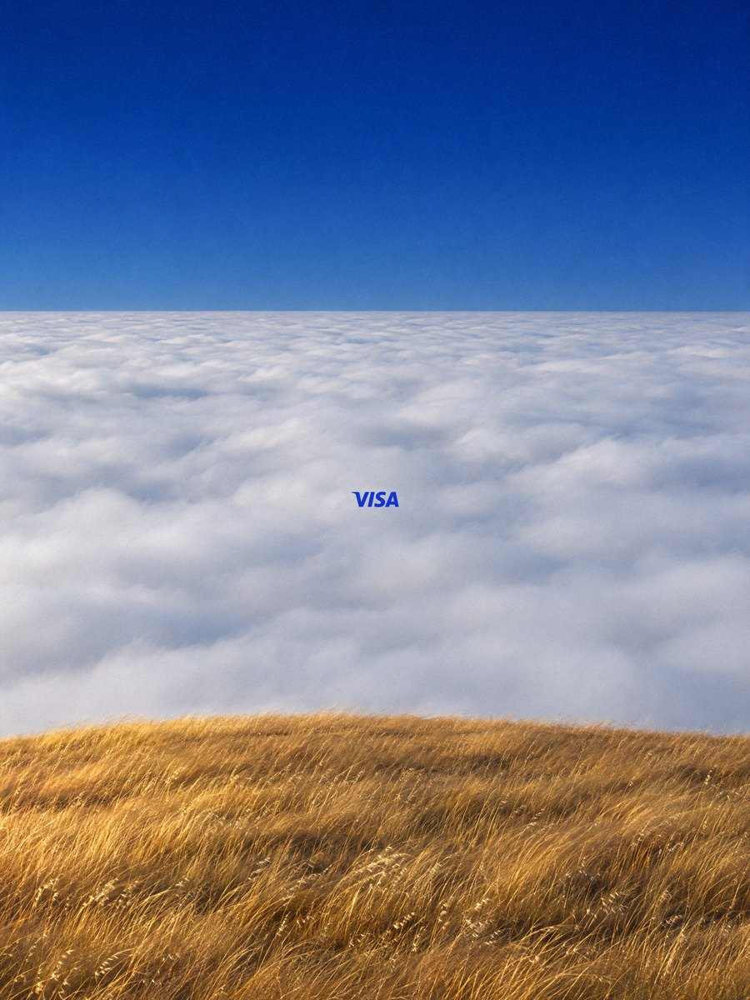
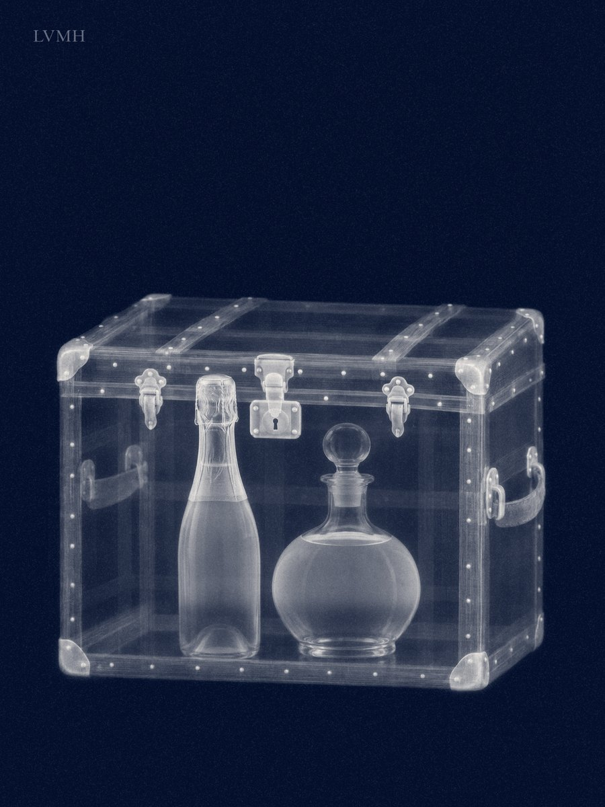
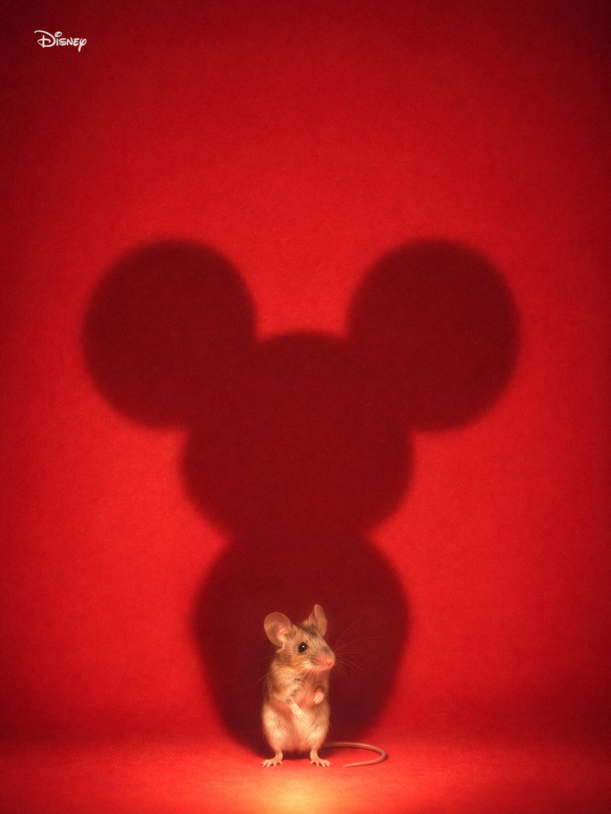
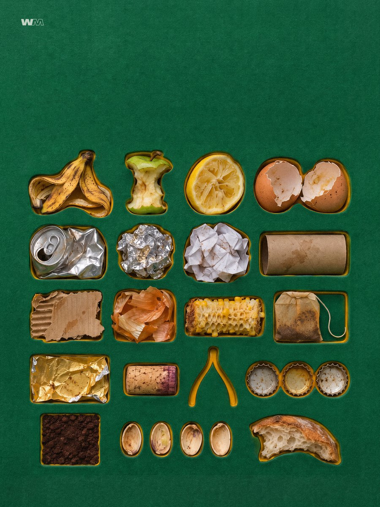
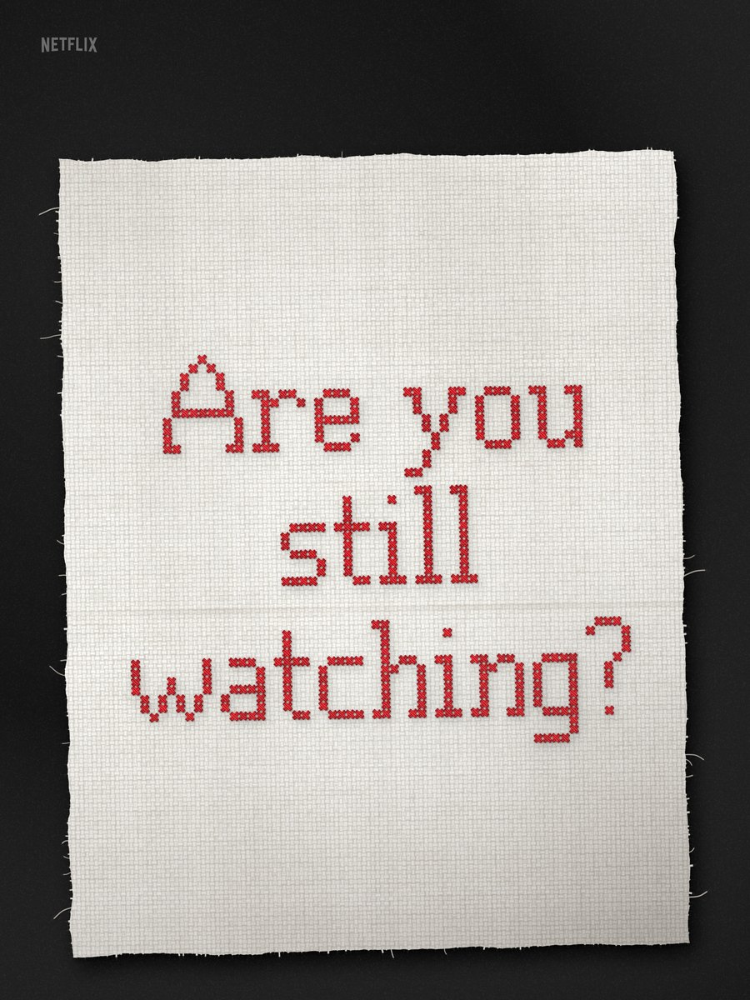
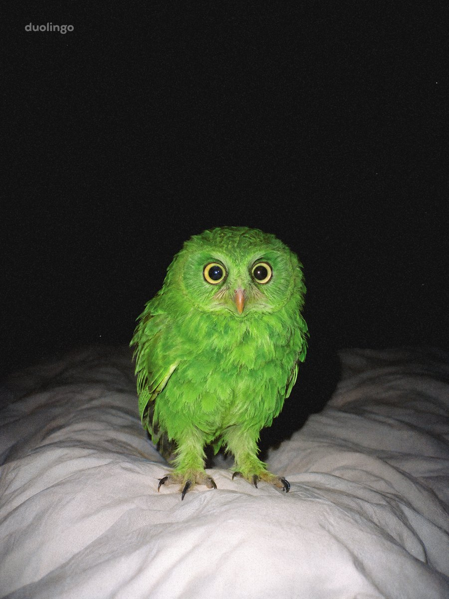

# charles-create-posters

<p align="center">






</p>

Posters with the art direction of Quartr's viral posters on X: one witty picture that could only be that company,
made like a real photograph or print, in its own colours, with almost no type. For any company, brand or project.

Agents with nothing but this skill and a company's name made these six. Blind judges ranked every one of them above
all the real Quartr posters they were shown with.

```bash
npx skills add LemonFace0309/charles-skills --skill charles-create-posters
```

Add `-g` to install it for every project, or copy this folder into `~/.claude/skills/` (Claude Code) or
`~/.agents/skills/` (Codex).

## What it does

- Researches the subject's world (its name, logo, founder, product, motto, heritage and news), writes 20+ ideas,
  scores them and keeps the one that could only be that subject
- Makes the picture the way the originals were made: a photograph from an image model, a print, pixels, type or a
  collage, in the brand's real colours
- Keeps the type almost silent: the picture and the subject's logo by default, your own words if you give some, and
  an earnings-call or event layer only when you ask for one
- Adds film grain or paper, renders 2520 × 3360 and checks it beside the real posters at feed size

## Try it

```text
/charles-create-posters a poster for Patagonia
/charles-create-posters a launch poster for my app, with the line "Out now"
/charles-create-posters an earnings-call poster for Nike's next call, posted by my newsletter
/charles-create-posters critique this poster: ./poster.png
```

## Needs

Bun or Node 18+, Google Chrome, ffmpeg, and a fal.ai key (`FAL_KEY`) for the pictures. A poster costs $1–3 in image
calls.

## Pairs with

[charles-hero-mockups](../charles-hero-mockups/) for landing-page heroes in the same poster spirit, and
[charles-color-analysis](../../design/charles-color-analysis/) to check a palette.

## Credits

The style, and the 22 posters it studies, are Quartr's: by Oliver Hamrin, Haris Cehic and Jacob Titus. The skill
takes their art direction, never their branding: no Quartr name, wordmark or tagline on a poster, and it downloads
their posters for study rather than shipping them.
