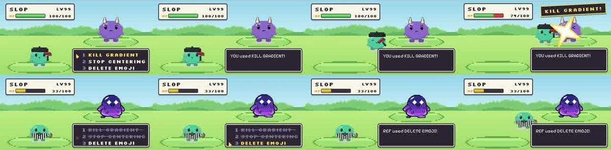

# charles-arcade-assets



Makes retro pixel-art motion graphics timed to a voiceover.

```bash
npx skills add LemonFace0309/charles-skills --skill charles-arcade-assets
```

Add `-g` to install it for every project, or copy this folder into `~/.claude/skills/` (Claude Code) or
`~/.agents/skills/` (Codex).

## What it does

- Has a pixel mascot act out every line, with rebuilt app screens and the real pages, logos and photos the words
  name, each landing on its word
- Renders a whole reel, or a card, split panel or overlay at the size your edit needs
- Keeps one cast and one look across every size of the same video

## Try it

```text
/charles-arcade-assets a pixel-art reel for voiceover.m4a
/charles-arcade-assets a 1280x630 card for 4.2-9.8 s of edit.mp4
```

## Needs

Node 22+, Python 3 with Pillow and numpy, ffmpeg, Google Chrome, and a fal.ai key (`FAL_KEY`) for the art. It renders
with HyperFrames, which runs through npx. My sprite library isn't included: the Claude critter and its neutral
cousin are drawn in code, `tools/cast.py new` makes any other character from a description or a photo, and
`ARCADE_CAST` points the skill at a library of your own.

## Pairs with

[charles-claude-editing](../charles-claude-editing/), which picks the layout and asks for an asset at that size.
