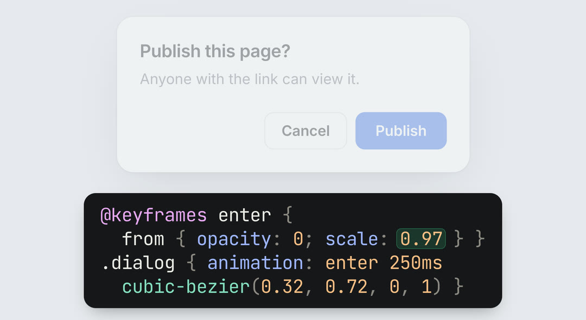

# charles-explainers-assets

<p align="center">


</p>

Builds the visual for each point you make in a reel, timed to your words, in a clean look or a colourful studio look.

```bash
npx skills add LemonFace0309/charles-skills --skill charles-explainers-assets
```

Add `-g` to install it for every project, or copy this folder into `~/.claude/skills/` (Claude Code) or
`~/.agents/skills/` (Codex).

## What it does

- Picks the form each line needs: a fix that flips from before to after on your word, a principle side by side
  without it and with it, the real thing marked in red, or a term's definition above a demo. In a fast list, each
  card is the after alone
- Builds it in one of two looks, which change how a card looks but never what it does:
  - **Clean:** the real component and its code on a calm grey ground, with red-to-green marks on what changes,
    targets, and an agent cursor that makes the change
  - **Studio:** colourful and playful: a moment from an app people know, a real page, or a photographed object that
    puns on the line, in a colour world lit from one side, with one move that sells the idea
- Keeps a series in the look its last video used, and asks which look when nothing says
- Sizes each clip for its slot in your edit, and keeps it simple enough to read in the second or two a phone viewer
  gets
- Checks every clip at phone size and frame by frame around the change. The studio look also improves the cards
  round by round with fresh critics, and checks that no two cards in a row share a colour
- Locks a studio project to the kit it was built with (`kit.lock`), so re-rendering an old set months later gives the
  same cards, or says the kit has changed

## Examples

The pair at the top is one fix from my animation hacks reel in the clean look, before and after the word, with its
CSS under it. Below are four studio cards from my 20 psychology principles reel: a 46-day streak whose flame gutters
as it resets at midnight, a candy game's out-of-moves screen, a dating app's blurred likes and a daily prize wheel.


## Try it

```text
/charles-explainers-assets a before and after for "use tabular numbers", for a 1080x960 card
/charles-explainers-assets a teaching visual for every line of script.md, in the clean look
/charles-explainers-assets these explainer cards are boring, make them look like this reference
/charles-explainers-assets studio cards for my 20 psychology principles list reel
```

## Needs

- Bun, Google Chrome and ffmpeg
- For the studio look's photographed objects: Python 3 with Pillow, and a fal key (`FAL_KEY`), or an OpenAI key
  (`OPENAI_API_KEY`) with `kit/studio/openai_gen.py`. A full set of 20-35 objects took under 10 minutes on
  GPT Image 2.6

## Pairs with

- [charles-claude-editing](../charles-claude-editing/), which asks for these at the size its layout needs
- [charles-reel-plans](../charles-reel-plans/), which puts the finished cards into the plan page's mockup of the reel
- [charles-3d-explainers](../charles-3d-explainers/) when an idea needs depth
- [charles-unreasonable-craft](../../design/charles-unreasonable-craft/): the critique rubric and the "render the
  directions" habit the studio look borrows

## Credits

The studio look's bar came from Tobi Donadon's [Construct Design](https://www.tobiadonadon.com/projects/construct/design)
and his article [How to Make Claude Design Like a Real Studio](https://x.com/tobiadonadon_/status/2124269680122638822).

The studio look was its own skill, charles-studio-explainers, until 25 Nov 2026.
