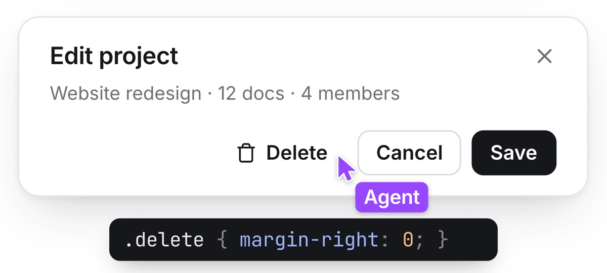
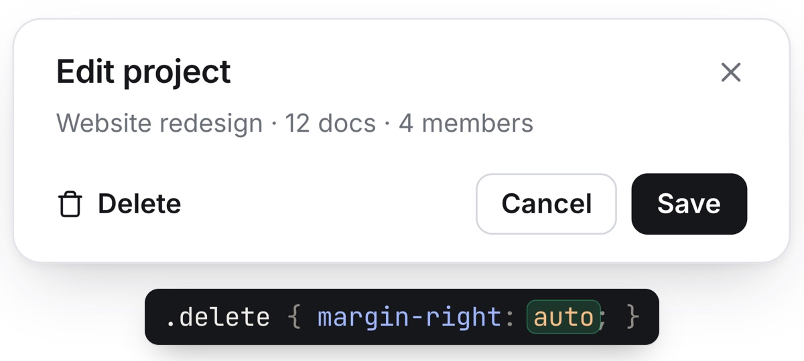
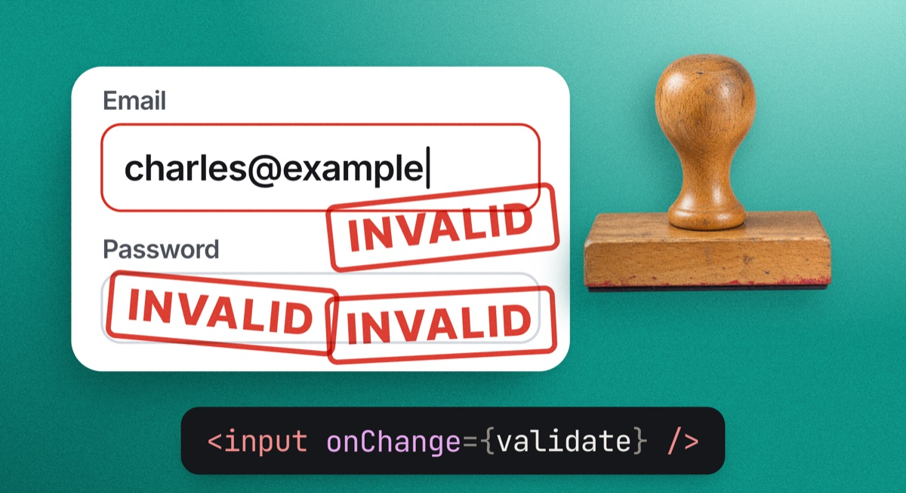
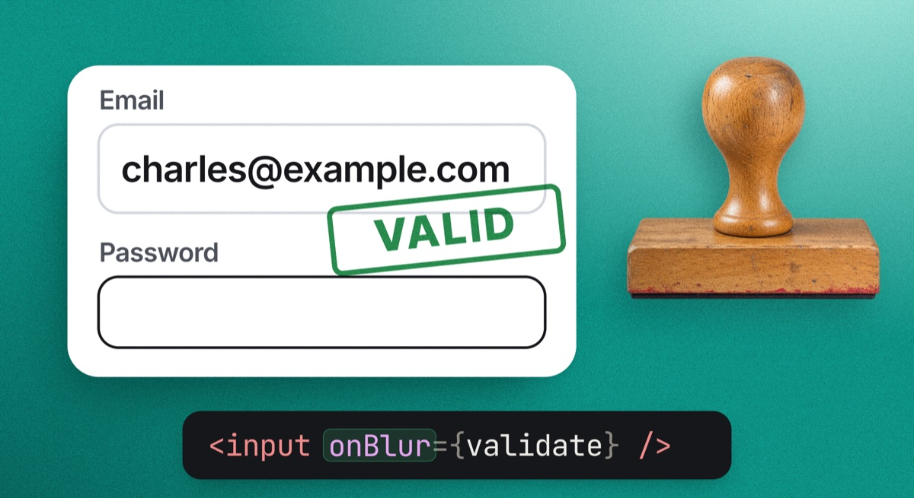
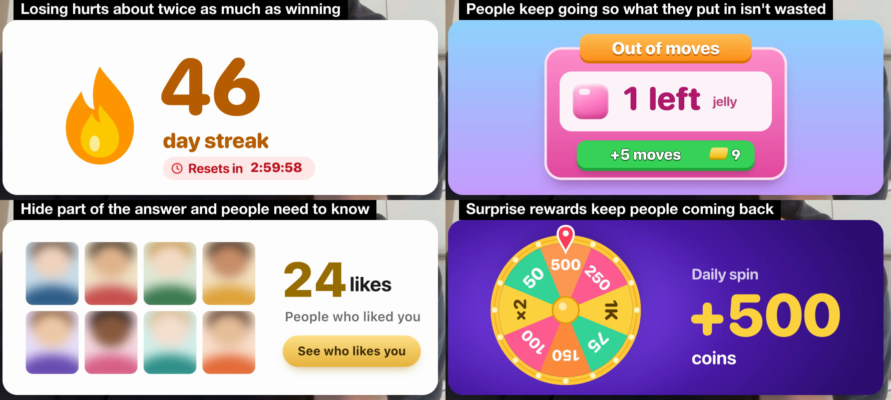

# charles-explainers-assets

<p align="center">




</p>

Builds the visual for each point you make in a reel, timed to your words, in one of two looks: clean (top) or playful
(bottom).

```bash
npx skills add LemonFace0309/charles-skills --skill charles-explainers-assets
```

Add `-g` to install it for every project, or copy this folder into `~/.claude/skills/` (Claude Code) or
`~/.agents/skills/` (Codex).

## What it does

- Picks the form each line needs: a fix that flips from before to after on your word, a principle side by side
  without it and with it, the real thing marked in red, or a term's definition above a demo. In a fast list, each
  card is the after alone
- Builds it in one of two looks, which change how a card looks but never what it does:
  - **Clean:** sleek and minimal. The real component and its code on a calm ground, with red-to-green marks on what
    changes, targets, and an agent cursor that makes the change
  - **Playful:** colourful and fun. A moment from an app people know, a real page, or a photographed object that
    puns on the line, in a colour world lit from one side, with one move that sells the idea
- Keeps a series in the look its last video used, and asks which look when nothing says
- Sizes each clip for its slot in your edit, and keeps it simple enough to read in the second or two a phone viewer
  gets
- Checks every clip at phone size and frame by frame around the change. The playful look also improves the cards
  round by round with fresh critics, and checks that no two cards in a row share a colour
- Locks a playful-look project to the kit it was built with (`kit.lock`), so re-rendering an old set months later
  gives the same cards, or says the kit has changed

## Examples

The pictures at the top are one fix in each look, a moment before and after the word:

- **Clean**, from my practical design tips reel: "Keep delete far away from the save button." The agent cursor
  moves Delete to the far left on the word, and the one CSS value that changed lights up.
- **Playful**, from design hacks part 2: "Don't show errors while people are still typing. Validate it after they've
  left the field." A rubber stamp marks the email INVALID at every keystroke. After the fix it waits until the field
  is left, then stamps VALID.

In a fast list, each playful card is the after alone. Four from my 20 psychology principles reel: a 46-day streak
whose flame gutters as it resets at midnight, a candy game's out-of-moves screen, a dating app's blurred likes and a
daily prize wheel.



## Try it

```text
/charles-explainers-assets a before and after for "use tabular numbers", for a 1080x960 card
/charles-explainers-assets a teaching visual for every line of script.md, in the clean look
/charles-explainers-assets these explainer cards are boring, make them playful like this reference
/charles-explainers-assets playful cards for my 20 psychology principles list reel
```

## Needs

- Bun, Google Chrome and ffmpeg
- For the playful look's photographed objects: Python 3 with Pillow, and a fal key (`FAL_KEY`), or an OpenAI key
  (`OPENAI_API_KEY`) with `kit/playful/openai_gen.py`. A full set of 20-35 objects took under 10 minutes on
  GPT Image 2.6

## Pairs with

- [charles-claude-editing](../charles-claude-editing/), which asks for these at the size its layout needs
- [charles-reel-plans](../charles-reel-plans/), which puts the finished cards into the plan page's mockup of the reel
- [charles-3d-explainers](../charles-3d-explainers/) when an idea needs depth
- [charles-unreasonable-craft](../../design/charles-unreasonable-craft/): the critique rubric and the "render the
  directions" habit the playful look borrows

## Credits

The playful look's bar came from Tobi Donadon's [Construct Design](https://www.tobiadonadon.com/projects/construct/design)
and his article [How to Make Claude Design Like a Real Studio](https://x.com/tobiadonadon_/status/2124269680122638822),
which is why it was first called the studio look. It was its own skill, charles-studio-explainers, until
25 Nov 2026.
