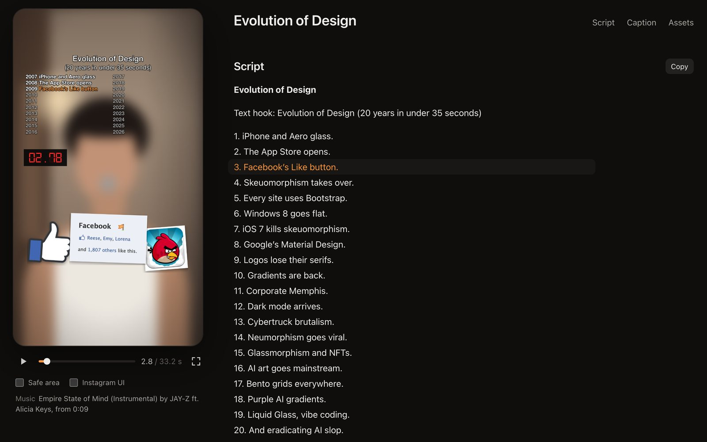

# charles-reel-plans

<p align="center">

</p>

Plans a reel before you film it, and gives you one page with everything for the video.

```bash
npx skills add LemonFace0309/charles-skills --skill charles-reel-plans
```

Add `-g` to install it for every project, or copy this folder into `~/.claude/skills/` (Claude Code) or
`~/.agents/skills/` (Codex).

## What it does

- Takes a video idea and a reference (one of your reels, someone else's, or a post to credit), tears the reference
  down, and writes the script in your voice
- Finds the real assets with their licences, writes the caption with the credit, and picks the music and where it starts
- Publishes a page you can open on your phone: the reel playing as a moving mockup with its music over a blurred
  stand-in for your footage, with full screen and toggles for the safe area and Instagram's UI, and beside it the
  script, the caption options to copy and every asset with its source

All that's left is to read the script and film, and the plan file tells the editing session what goes where.

## Examples

The page at the top is for "Evolution of Design", a 20-year list reel. The list fills in as you speak, with the newest
year in orange, the stopwatch runs, and each year's real artifacts sit under your chin, overlapping only at their edges.
The line playing lights up in the script, and a click on any line or asset jumps the reel there.

## Try it

```text
/charles-reel-plans an evolution of design reel, from this post, structured like my 22 Backgrounds reel
/charles-reel-plans why every app icon is a squircle, about 25 s, with a hook
```

## Needs

Python 3 with Pillow and NumPy, ffmpeg, and Google Chrome. Claude Code's Artifact tool publishes the page; without it,
`build/plan.html` opens from disk.

## Pairs with

[charles-scripting-voice](../charles-scripting-voice/) writes the script. It's tuned to how I talk, so swap in your
own voice skill or give it a few of your scripts. [charles-claude-editing](../charles-claude-editing/) edits the reel
from the plan file.
