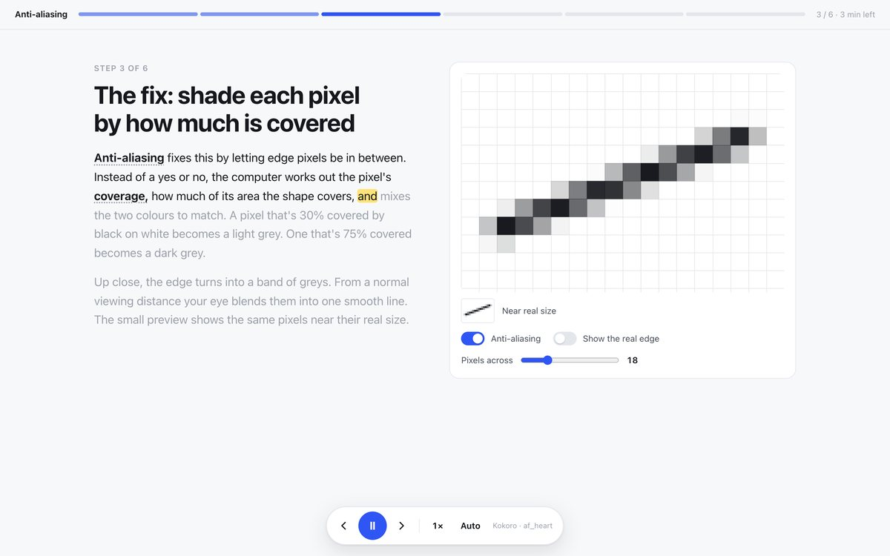

# charles-learn-anything



Turns any topic into a short interactive lesson that opens in Chrome and reads itself to you, highlighting each word as it goes.

```bash
npx skills add LemonFace0309/charles-skills --skill charles-learn-anything
```

Add `-g` to install it for every project, or copy this folder into `~/.claude/skills/` (Claude Code) or
`~/.agents/skills/` (Codex).

## What it does

- Breaks the topic into 4 to 7 one-idea steps, with the key terms and an outline before you start
- Asks you to predict first where people usually guess wrong, then shows the answer, and checks you with a quick question after a few steps
- Gives the hard ideas a small demo you can play with, which changes on the exact word the narrator says
- Hangs every idea on a real-life example, sets the stand-out facts apart, ends each step with dot jots, and gives you an acronym or a phrase when there's a set to remember
- Checks every stand-out fact and real-world number against a source, and lists the sources at the end, so you can check them too
- Reads it all in a natural voice at 0.75x to 2x, with Space to pause and the arrow keys to move between steps

Every choice comes from learning research (pre-training, segmenting, predicting before the reveal, quizzing with
feedback, changing the picture on the word). `references/learning.md` has the numbers and the sources.

## Examples

The lesson in the picture is `examples/anti-aliasing`: six steps and about four minutes at 1x, with one pixel demo
that four steps set up differently, an animation of jagged edges crawling as they turn, two stand-out facts and a memory aid for the three shortcuts games use. Its voice cost $0.07.

## Try it

```text
/charles-learn-anything help me understand anti-aliasing
/charles-learn-anything teach me how compound interest actually works
/charles-learn-anything walk me through how HTTPS keeps data private
```

## Needs

Python 3 and Google Chrome. For the natural voice, a fal.ai key (`FAL_KEY`) in your environment or a `.env` file. It
costs about $0.02 per 1,000 characters, so about $0.12 for a full 6-minute lesson, and a rebuild only pays for
sentences that changed. Without a key, the page uses your browser's own voice for free. ffmpeg, if you have it, keeps
the audio files small.

## Pairs with

[charles-eli14](../charles-eli14/) when you want a short answer in the chat instead of a lesson.
